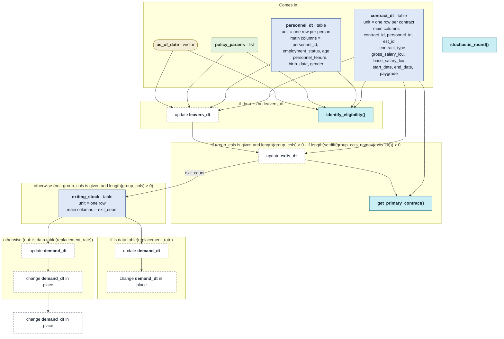

# `compute_flow_demand()`

Generated by `data-raw/schemas/build_code_map.R` from `R/hiring_core.R`. Do not edit by hand.

Steps with their own flow: 
- [`identify_eligibility()`](identify_eligibility.md)
