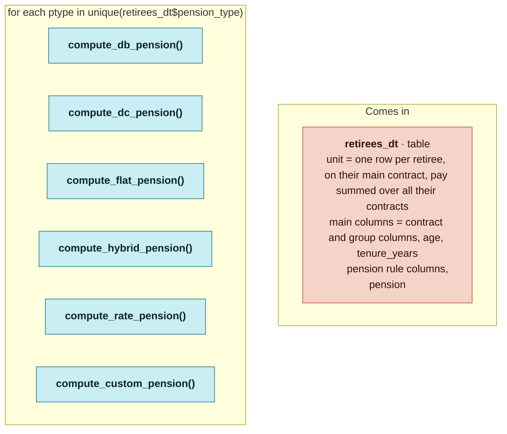

# `compute_pension()`

Generated by `data-raw/schemas/build_code_map.R` from `R/retirement_pension.R`. Do not edit by hand.

Steps with their own flow: 
- [`compute_hybrid_pension()`](compute_hybrid_pension.md)
- [`compute_custom_pension()`](compute_custom_pension.md)
