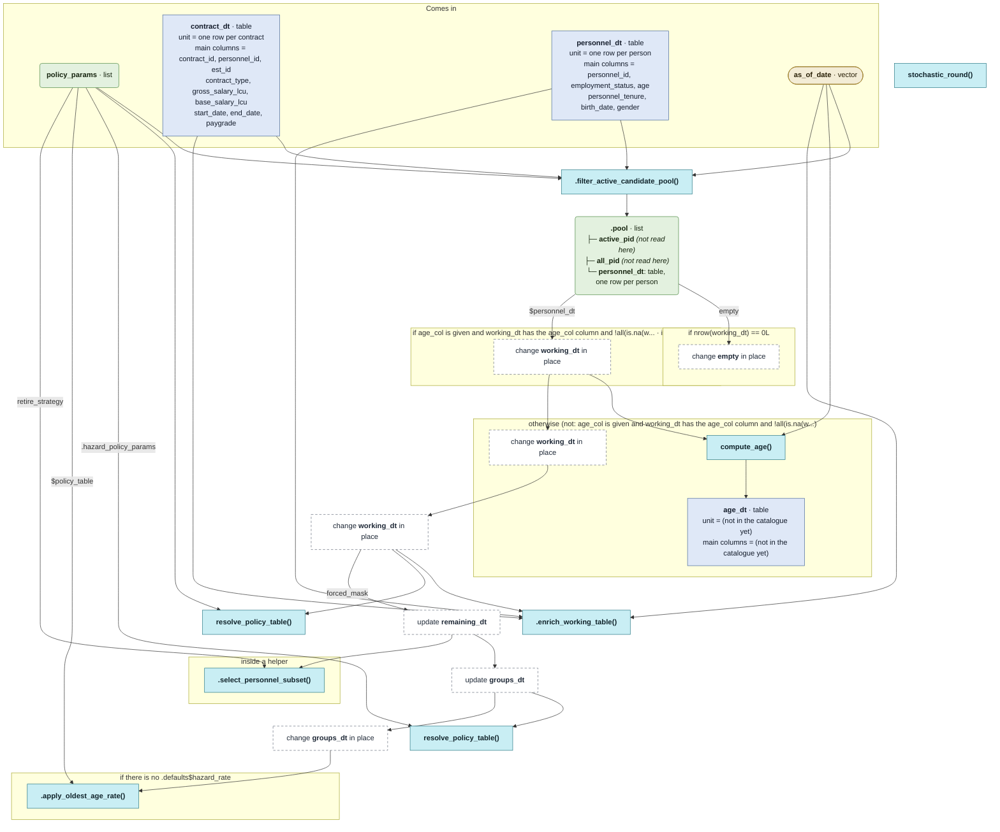

# `compute_status_quo_retirements()`

Generated by `data-raw/schemas/build_code_map.R` from `R/retirement_core.R`. Do not edit by hand.

Steps with their own flow: 
- [`.filter_active_candidate_pool()`](dot-filter_active_candidate_pool.md)
- [`compute_age()`](compute_age.md)
- [`.enrich_working_table()`](dot-enrich_working_table.md)
