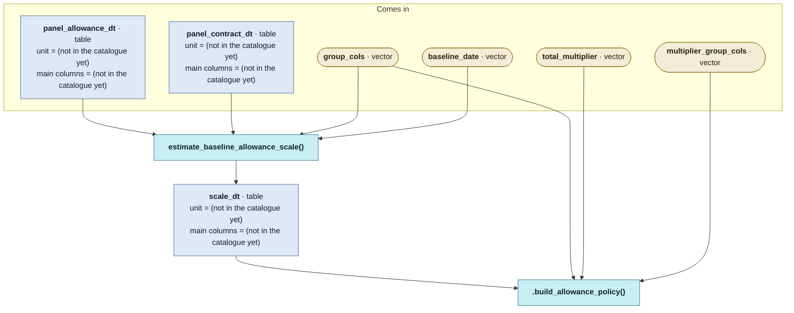

# `design_allowance_policy_status_quo()`

Generated by `data-raw/schemas/build_code_map.R` from `R/allowance_policy_helpers.R`. Do not edit by hand.

Steps with their own flow: 
- [`estimate_baseline_allowance_scale()`](estimate_baseline_allowance_scale.md)
