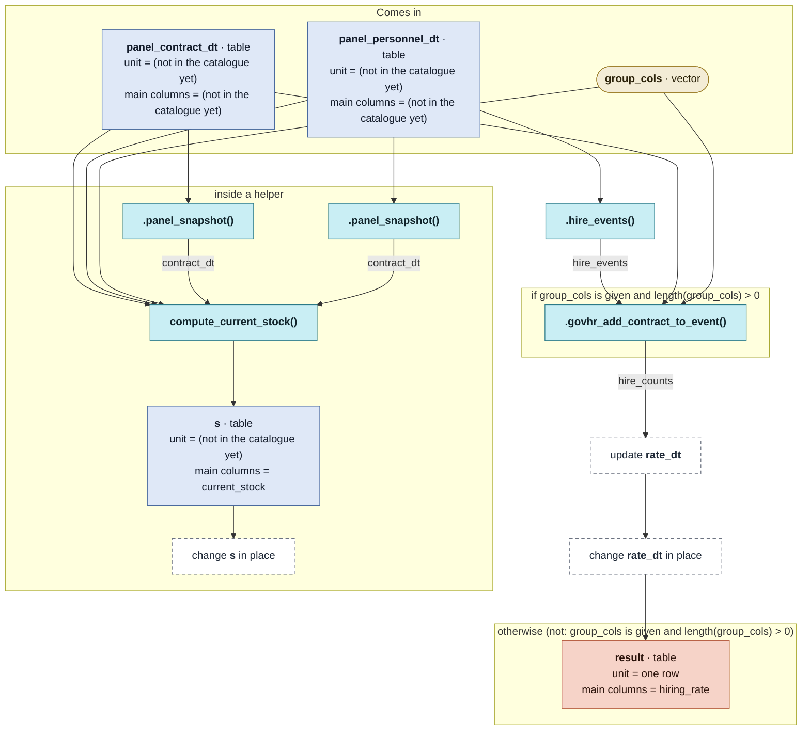

# `estimate_historical_hiring_rates()`

Generated by `data-raw/schemas/build_code_map.R` from `R/hiring_core.R`. Do not edit by hand.

Steps with their own flow: 
- [`.hire_events()`](dot-hire_events.md)
- [`compute_current_stock()`](compute_current_stock.md)
