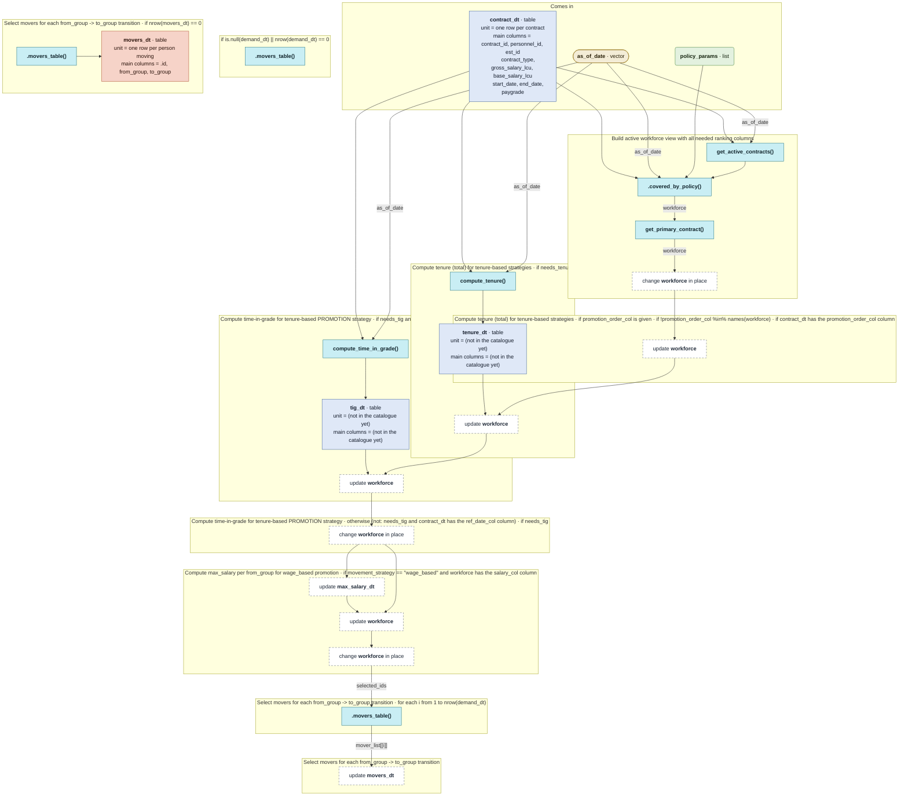

# `identify_movers()`

Generated by `data-raw/schemas/build_code_map.R` from `R/movement_update.R`. Do not edit by hand.

Steps with their own flow: 
- [`compute_time_in_grade()`](compute_time_in_grade.md)
