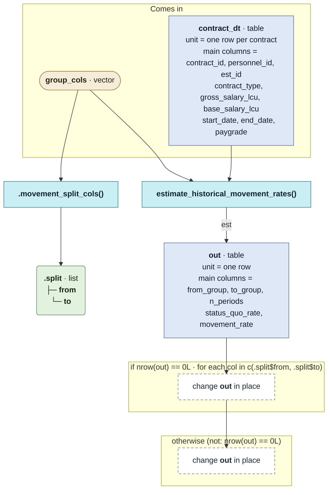

# `movement_policy_template()`

Generated by `data-raw/schemas/build_code_map.R` from `R/movement_policy_helpers.R`. Do not edit by hand.

Steps with their own flow: 
- [`estimate_historical_movement_rates()`](estimate_historical_movement_rates.md)
