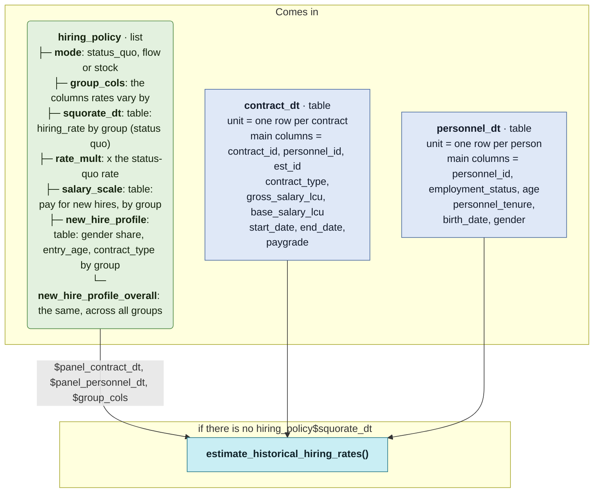

# `precompute_hiring_rates()`

Generated by `data-raw/schemas/build_code_map.R` from `R/horizon_core.R`. Do not edit by hand.

Steps with their own flow: 
- [`estimate_historical_hiring_rates()`](estimate_historical_hiring_rates.md)
