# `prepare_horizon_inputs()`

Generated by `data-raw/schemas/build_code_map.R` from `R/horizon_core.R`. Do not edit by hand.

```mermaid
flowchart TB
  subgraph G1["Comes in"]
    N1(["<b>n_periods</b> · vector"])
    N2["<b>contract_dt</b> · table<br/>unit = one row per contract<br/>main columns = contract_id, personnel_id, est_id<br/>#160;#160;#160;#160;#160;#160;#160;#160;contract_type, gross_salary_lcu, base_salary_lcu<br/>#160;#160;#160;#160;#160;#160;#160;#160;start_date, end_date, paygrade"]
    N3["<b>personnel_dt</b> · table<br/>unit = one row per person<br/>main columns = personnel_id, employment_status, age<br/>#160;#160;#160;#160;#160;#160;#160;#160;personnel_tenure, birth_date, gender"]
    N4(["<b>salary_growth_rate</b> · vector"])
    N5(["<b>pension_cola_rate</b> · vector"])
    N6(["<b>allowance_growth_rate</b> · vector"])
    N8("<b>movement_policy</b> · list<br/>├─ <b>group_cols</b>: the columns that make a group<br/>├─ <b>policy_table</b>: table: movement_rate from_group -#gt; to_group<br/>└─ <b>defaults</b>: list<br/>#160;#160;#160;#160;├─ <b>movement_type</b>: promotion or transfer<br/>#160;#160;#160;#160;├─ <b>movement_strategy</b>: who moves first<br/>#160;#160;#160;#160;└─ <b>salary_update_rule</b>: what happens to pay")
    N11("<b>exit_policy</b> · list<br/>├─ <b>group_cols</b>: the columns rates vary by, or NULL<br/>├─ <b>policy_table</b>: table: exit_rate by group<br/>└─ <b>defaults</b>: list<br/>#160;#160;#160;#160;├─ <b>exit_rate</b>: a flat rate, or<br/>#160;#160;#160;#160;├─ <b>exit_multiplier</b>: x the status-quo rate<br/>#160;#160;#160;#160;├─ <b>exit_strategy</b>: who goes first<br/>#160;#160;#160;#160;└─ <b>active_types</b>: contract types that can exit")
    N14("<b>retirement_policy</b> · list<br/>├─ <b>group_cols</b>: the columns rates vary by, or NULL<br/>├─ <b>policy_table</b>: table: hazard_rate by age_yr_int (x group)<br/>└─ <b>defaults</b>: list<br/>#160;#160;#160;#160;├─ <b>eligibility_type</b>: e.g. hazard_rate<br/>#160;#160;#160;#160;├─ <b>min_age</b>: mandatory age<br/>#160;#160;#160;#160;├─ <b>retire_strategy</b>: who goes first<br/>#160;#160;#160;#160;├─ <b>pension_type</b>: e.g. db<br/>#160;#160;#160;#160;└─ <b>accrual_rate, max_years, replacement_cap</b>: the pension rule")
    N17("<b>hiring_policy</b> · list<br/>├─ <b>mode</b>: status_quo, flow or stock<br/>├─ <b>group_cols</b>: the columns rates vary by<br/>├─ <b>squorate_dt</b>: table: hiring_rate by group (status quo)<br/>├─ <b>rate_mult</b>: x the status-quo rate<br/>├─ <b>salary_scale</b>: table: pay for new hires, by group<br/>├─ <b>new_hire_profile</b>: table: gender share, entry_age, contract_type by group<br/>└─ <b>new_hire_profile_overall</b>: the same, across all groups")
    N35("<b>allowance_policy</b> · list<br/>├─ <b>group_cols</b>: the group columns, with allowance_type<br/>├─ <b>policy_table</b>: table: amount by group x allowance_type<br/>└─ <b>defaults</b>: list<br/>#160;#160;#160;#160;└─ <b>amount</b>: for groups without a row")
    N38["<b>salary_scale_dt</b> · table<br/>unit = one row per pay group<br/>main columns = the group columns, e.g. est_id, gross_salary_lcu"]
  end
  subgraph G2["0. Validate and set up"]
    N7["<b>precompute_movement_rates()</b>"]
    N9("<b>movement_policy</b> · list<br/>├─ <b>group_cols</b>: the columns that make a group<br/>├─ <b>policy_table</b>: table: movement_rate from_group -#gt; to_group<br/>└─ <b>defaults</b>: list<br/>#160;#160;#160;#160;├─ <b>movement_type</b>: promotion or transfer<br/>#160;#160;#160;#160;├─ <b>movement_strategy</b>: who moves first<br/>#160;#160;#160;#160;└─ <b>salary_update_rule</b>: what happens to pay")
    N10["<b>precompute_exit_rates()</b>"]
    N12("<b>exit_policy</b> · list<br/>├─ <b>group_cols</b>: the columns rates vary by, or NULL<br/>├─ <b>policy_table</b>: table: exit_rate by group<br/>└─ <b>defaults</b>: list<br/>#160;#160;#160;#160;├─ <b>exit_rate</b>: a flat rate, or<br/>#160;#160;#160;#160;├─ <b>exit_multiplier</b>: x the status-quo rate<br/>#160;#160;#160;#160;├─ <b>exit_strategy</b>: who goes first<br/>#160;#160;#160;#160;└─ <b>active_types</b>: contract types that can exit")
    N13["<b>precompute_retirement_rates()</b>"]
    N15("<b>retirement_policy</b> · list<br/>├─ <b>group_cols</b>: the columns rates vary by, or NULL<br/>├─ <b>policy_table</b>: table: hazard_rate by age_yr_int (x group)<br/>└─ <b>defaults</b>: list<br/>#160;#160;#160;#160;├─ <b>eligibility_type</b>: e.g. hazard_rate<br/>#160;#160;#160;#160;├─ <b>min_age</b>: mandatory age<br/>#160;#160;#160;#160;├─ <b>retire_strategy</b>: who goes first<br/>#160;#160;#160;#160;├─ <b>pension_type</b>: e.g. db<br/>#160;#160;#160;#160;└─ <b>accrual_rate, max_years, replacement_cap</b>: the pension rule")
    N16["<b>precompute_hiring_rates()</b>"]
    N18("<b>hiring_policy</b> · list<br/>├─ <b>mode</b>: status_quo, flow or stock<br/>├─ <b>group_cols</b>: the columns rates vary by<br/>├─ <b>squorate_dt</b>: table: hiring_rate by group (status quo)<br/>├─ <b>rate_mult</b>: x the status-quo rate<br/>├─ <b>salary_scale</b>: table: pay for new hires, by group<br/>├─ <b>new_hire_profile</b>: table: gender share, entry_age, contract_type by group<br/>└─ <b>new_hire_profile_overall</b>: the same, across all groups")
    N19["<b>precompute_new_hire_profile()</b>"]
    N20("<b>hiring_policy</b> · list<br/>├─ <b>new_hire_profile</b><br/>└─ <b>new_hire_profile_overall</b>")
    N23["update <b>contract_dt</b>"]
    N24["change <b>contract_dt</b> in place"]
    N25["<b>.empty_pensioner_register()</b>"]
    N26["<b>pensioner_register</b> · table<br/>unit = one row per pension contract (returned: per contract per year)<br/>main columns = personnel_id, contract_id, pension_amount<br/>#160;#160;#160;#160;#160;#160;#160;#160;ref_date (returned only)"]
  end
  subgraph G8["0. Validate and set up · if contract_dt has the ref_date_col column"]
    N21["update <b>contract_dt</b>"]
  end
  subgraph G9["0. Validate and set up · if personnel_dt has the ref_date_col column"]
    N22["update <b>personnel_dt</b>"]
  end
  subgraph G10["0. Validate and set up · if nrow(existing_pensioners) #gt; 0L"]
    N27["change <b>seed_reg</b> in place"]
    N28["update <b>pensioner_register</b>"]
    N29["update <b>personnel_dt</b>"]
  end
  subgraph G12["Age and tenure at baseline_date, where the data do not hold them · if .age_missing_ and birth_date_col is given and birth_date_col %in% na..."]
    N30["change <b>personnel_dt</b> in place"]
  end
  subgraph G13["Age and tenure at baseline_date, where the data do not hold them · if .tenure_missing_"]
    N31["<b>compute_tenure()</b>"]
  end
  subgraph G14["Age and tenure at baseline_date, where the data do not hold them · if .tenure_missing_ · if nrow(tenure_init) #gt; 0L · if is.integer(personnel_dt[[tenure_col]])"]
    N32["change <b>personnel_dt</b> in place"]
  end
  subgraph G15["Age and tenure at baseline_date, where the data do not hold them · if .tenure_missing_ · if nrow(tenure_init) #gt; 0L"]
    N33["change <b>personnel_dt</b> in place"]
  end
  subgraph G16["Age and tenure at baseline_date, where the data do not hold them · if allowance_policy is given"]
    N34["<b>simulate_allowances()</b>"]
    N36("<b>alw0</b> · list<br/>├─ <b>allowance_dt</b>: table, one row per contract, allowance type and year <i>(not read here)</i><br/>├─ <b>contract_dt</b>: table, one row per contract <i>(not read here)</i><br/>├─ <b>personnel_dt</b>: table, one row per person <i>(not read here)</i><br/>└─ <b>summary</b>: table, one row: this step's counts and costs")
  end
  subgraph G17["Hands back"]
    N37("<b>result</b> · list<br/>├─ <b>contract_dt</b>: table, one row per contract<br/>├─ <b>personnel_dt</b>: table, one row per person<br/>├─ <b>salary_scale_dt</b>: table, one row per pay group<br/>├─ <b>pensioner_register</b>: table, one row per pension contract (returned: per contract per year)<br/>├─ <b>retirement_policy</b>: list<br/>├─ <b>exit_policy</b>: list<br/>├─ <b>movement_policy</b>: list<br/>├─ <b>hiring_policy</b>: list<br/>├─ <b>column_spec_args</b><br/>├─ <b>baseline_date</b><br/>├─ <b>n_periods</b><br/>├─ <b>salary_growth_rate</b><br/>├─ <b>pension_cola_rate</b><br/>├─ <b>allowance_growth_rate</b><br/>├─ <b>period0_allowance_cost</b><br/>├─ <b>pension_contracts</b><br/>└─ <b>pension_people</b>")
  end
  N8 --> N7
  N2 -->|"has_panel"| N7
  N7 --> N9
  N11 --> N10
  N2 -->|"has_panel"| N10
  N3 --> N10
  N10 --> N12
  N14 --> N13
  N3 --> N13
  N2 -->|"has_panel"| N13
  N13 --> N15
  N17 --> N16
  N2 -->|"has_panel"| N16
  N3 --> N16
  N16 --> N18
  N18 --> N19
  N2 -->|"has_panel"| N19
  N3 --> N19
  N19 --> N20
  N2 --> N21
  N3 -->|"baseline_date"| N21
  N3 -->|"baseline_date"| N22
  N21 -->|".is_pension_row_"| N23
  N23 --> N24
  N25 --> N26
  N21 -->|"seed_reg"| N27
  N26 --> N28
  N27 --> N28
  N22 --> N29
  N21 -->|"pension_only"| N29
  N29 --> N30
  N24 --> N31
  N3 -->|"baseline_date"| N31
  N30 --> N32
  N32 --> N33
  N24 --> N34
  N33 --> N34
  N35 --> N34
  N3 -->|"baseline_date"| N34
  N34 --> N36
  N24 -->|"contract_dt"| N37
  N33 -->|"personnel_dt"| N37
  N38 -->|"salary_scale_dt"| N37
  N28 -->|"pensioner_register"| N37
  N15 -->|"retirement_policy"| N37
  N12 -->|"exit_policy"| N37
  N9 -->|"movement_policy"| N37
  N20 -->|"hiring_policy"| N37
  N3 -->|"baseline_date"| N37
  N1 -->|"n_periods, salary_growth_rate, pension_cola_rate, allowance_growth_rate"| N37
  N36 -->|"period0_allowance_cost"| N37
  N21 -->|"pension_contracts"| N37
  N22 -->|"pension_people"| N37
  classDef fn fill:#c9eef4,stroke:#2b7a87,color:#10232a
  classDef tbl fill:#dfe8f7,stroke:#4a6a9e,color:#141c2b
  classDef lst fill:#e3f1df,stroke:#4f8a45,color:#16240f
  classDef vec fill:#f3ecd6,stroke:#9a7b25,color:#2a2108
  classDef inl fill:#ffffff,stroke:#6b7280,stroke-dasharray:5 4,color:#1f2937
  classDef res fill:#f6d3c8,stroke:#b4573a,color:#2b130b
  class N7,N10,N13,N16,N19,N25,N31,N34 fn
  class N2,N3,N26,N38 tbl
  class N8,N9,N11,N12,N14,N15,N17,N18,N20,N35,N36 lst
  class N1,N4,N5,N6 vec
  class N21,N22,N23,N24,N27,N28,N29,N30,N32,N33 inl
  class N37 res
```

Steps with their own flow: 
- [`precompute_movement_rates()`](precompute_movement_rates.md)
- [`precompute_exit_rates()`](precompute_exit_rates.md)
- [`precompute_retirement_rates()`](precompute_retirement_rates.md)
- [`precompute_hiring_rates()`](precompute_hiring_rates.md)
- [`precompute_new_hire_profile()`](precompute_new_hire_profile.md)
- [`simulate_allowances()`](simulate_allowances.md)
