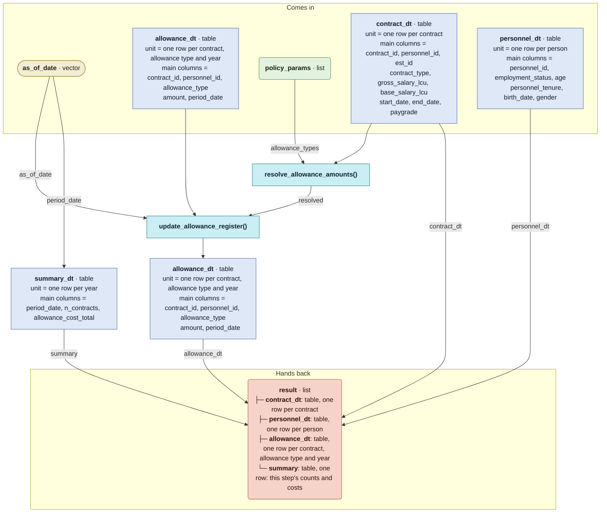

# `simulate_allowances()`

Generated by `data-raw/schemas/build_code_map.R` from `R/simulate_allowances.R`. Do not edit by hand.

Steps with their own flow: 
- [`resolve_allowance_amounts()`](resolve_allowance_amounts.md)
