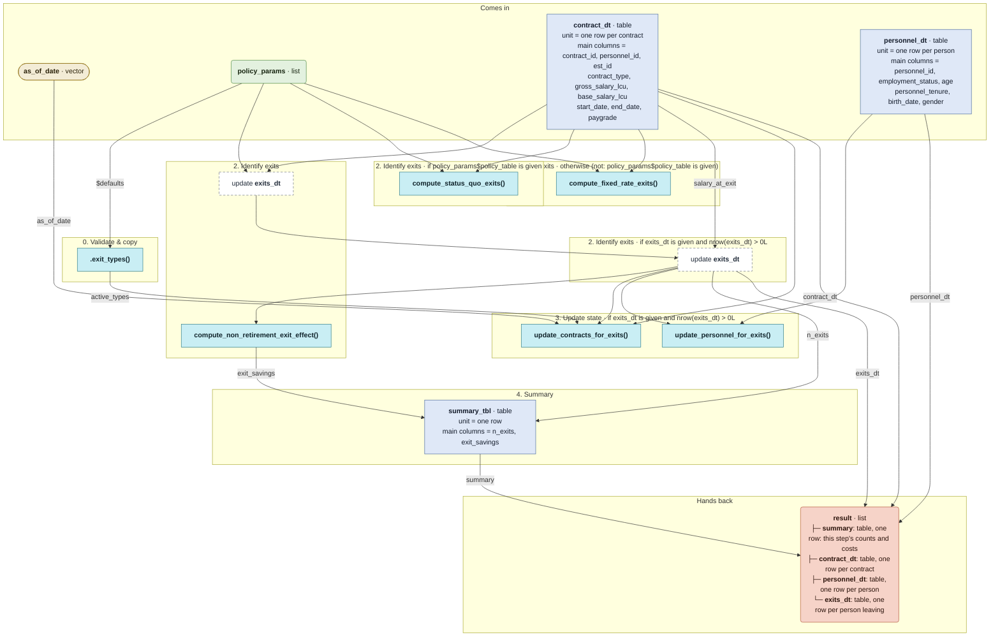

# `simulate_exits()`

Generated by `data-raw/schemas/build_code_map.R` from `R/simulate_exits.R`. Do not edit by hand.

Steps with their own flow: 
- [`compute_status_quo_exits()`](compute_status_quo_exits.md)
- [`compute_fixed_rate_exits()`](compute_fixed_rate_exits.md)
