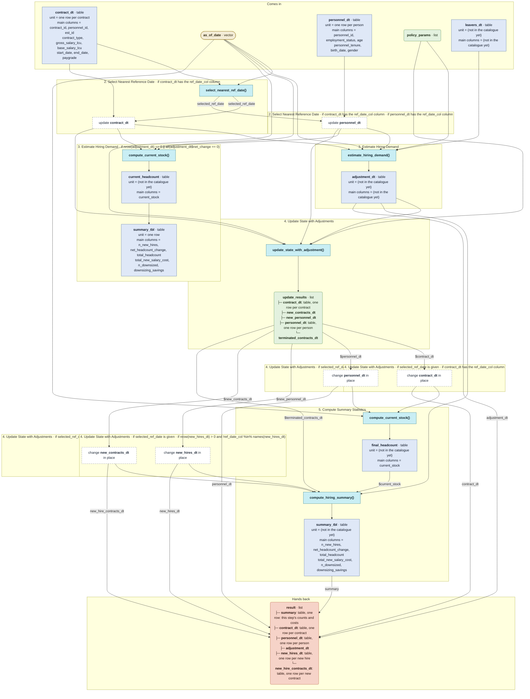

# `simulate_hiring()`

Generated by `data-raw/schemas/build_code_map.R` from `R/simulate_hiring.R`. Do not edit by hand.

Steps with their own flow: 
- [`estimate_hiring_demand()`](estimate_hiring_demand.md)
- [`compute_current_stock()`](compute_current_stock.md)
- [`update_state_with_adjustment()`](update_state_with_adjustment.md)
