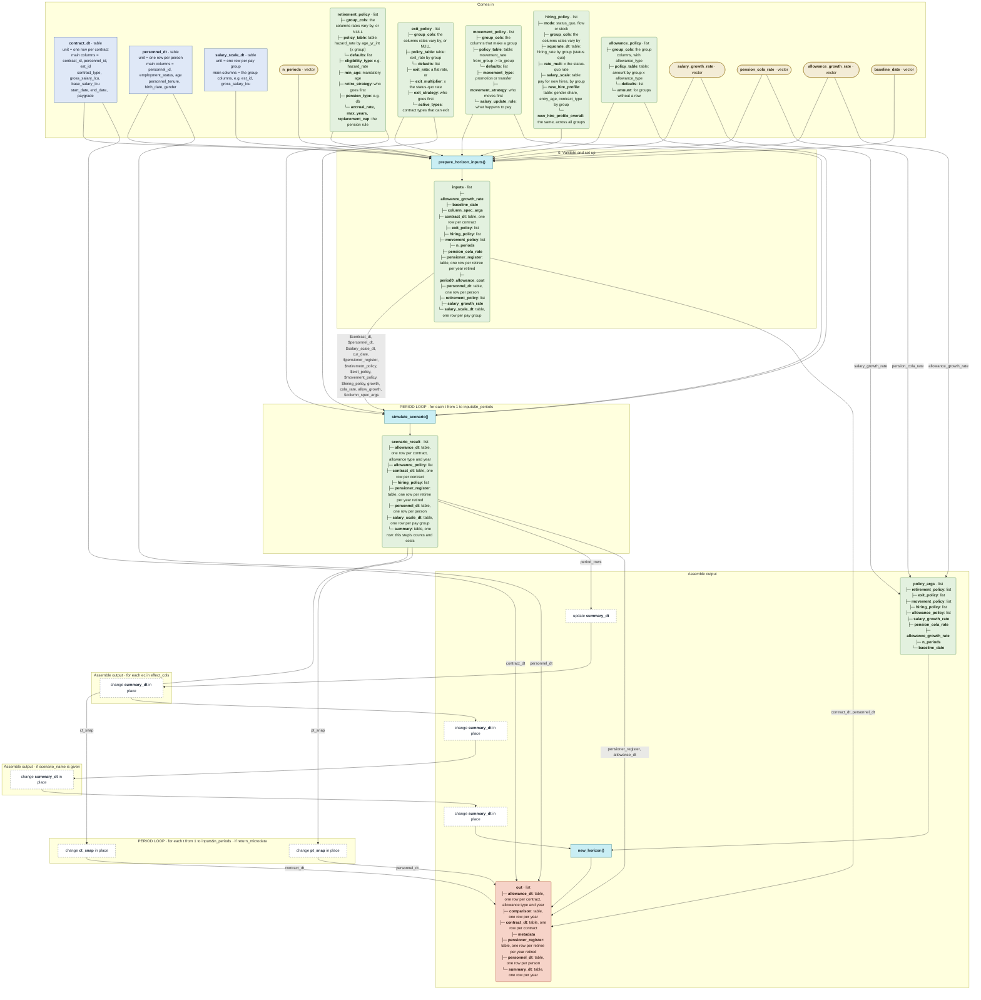

# `simulate_horizon()`

Generated by `data-raw/schemas/build_code_map.R` from `R/simulate_horizon.R`. Do not edit by hand.

Steps with their own flow: 
- [`prepare_horizon_inputs()`](prepare_horizon_inputs.md)
- [`simulate_scenario()`](simulate_scenario.md)
