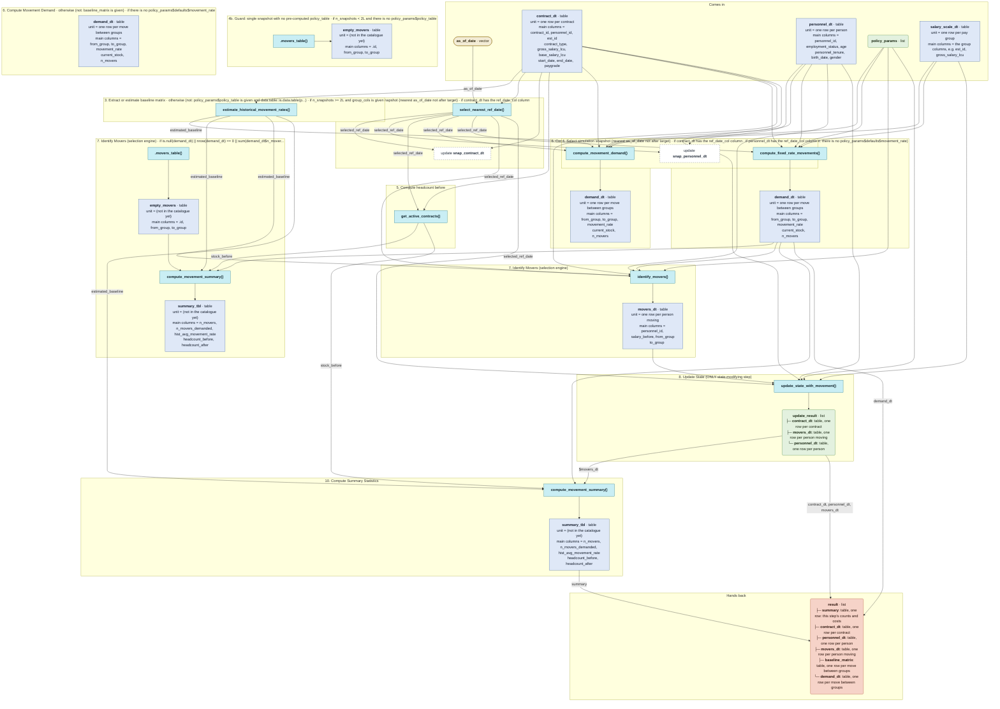

# `simulate_promotions_transfers()`

Generated by `data-raw/schemas/build_code_map.R` from `R/simulate_promotions_transfers.R`. Do not edit by hand.

Steps with their own flow: 
- [`estimate_historical_movement_rates()`](estimate_historical_movement_rates.md)
- [`compute_movement_demand()`](compute_movement_demand.md)
- [`compute_fixed_rate_movements()`](compute_fixed_rate_movements.md)
- [`identify_movers()`](identify_movers.md)
- [`update_state_with_movement()`](update_state_with_movement.md)
