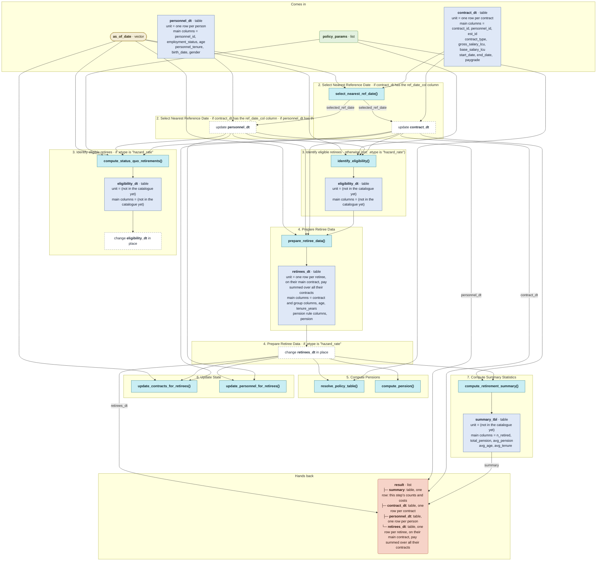

# `simulate_retirement()`

Generated by `data-raw/schemas/build_code_map.R` from `R/simulate_retirement.R`. Do not edit by hand.

Steps with their own flow: 
- [`compute_status_quo_retirements()`](compute_status_quo_retirements.md)
- [`identify_eligibility()`](identify_eligibility.md)
- [`prepare_retiree_data()`](prepare_retiree_data.md)
- [`compute_pension()`](compute_pension.md)
