# `simulate_scenario()`

Generated by `data-raw/schemas/build_code_map.R` from `R/simulate_horizon.R`. Do not edit by hand.

```mermaid
flowchart TB
  subgraph G1["Comes in"]
    N1(["<b>period_date</b> · vector"])
    N4["<b>contract_dt</b> · table<br/>unit = one row per contract<br/>main columns = contract_id, personnel_id, est_id<br/>#160;#160;#160;#160;#160;#160;#160;#160;contract_type, gross_salary_lcu, base_salary_lcu<br/>#160;#160;#160;#160;#160;#160;#160;#160;start_date, end_date, paygrade"]
    N7["<b>personnel_dt</b> · table<br/>unit = one row per person<br/>main columns = personnel_id, employment_status, age<br/>#160;#160;#160;#160;#160;#160;#160;#160;personnel_tenure, birth_date, gender"]
    N8("<b>retirement_policy</b> · list<br/>├─ <b>group_cols</b>: the columns rates vary by, or NULL<br/>├─ <b>policy_table</b>: table: hazard_rate by age_yr_int (x group)<br/>└─ <b>defaults</b>: list<br/>#160;#160;#160;#160;├─ <b>eligibility_type</b>: e.g. hazard_rate<br/>#160;#160;#160;#160;├─ <b>min_age</b>: mandatory age<br/>#160;#160;#160;#160;├─ <b>retire_strategy</b>: who goes first<br/>#160;#160;#160;#160;├─ <b>pension_type</b>: e.g. db<br/>#160;#160;#160;#160;└─ <b>accrual_rate, max_years, replacement_cap</b>: the pension rule")
    N14("<b>exit_policy</b> · list<br/>├─ <b>group_cols</b>: the columns rates vary by, or NULL<br/>├─ <b>policy_table</b>: table: exit_rate by group<br/>└─ <b>defaults</b>: list<br/>#160;#160;#160;#160;├─ <b>exit_rate</b>: a flat rate, or<br/>#160;#160;#160;#160;├─ <b>exit_multiplier</b>: x the status-quo rate<br/>#160;#160;#160;#160;├─ <b>exit_strategy</b>: who goes first<br/>#160;#160;#160;#160;└─ <b>active_types</b>: contract types that can exit")
    N17["<b>salary_scale_dt</b> · table<br/>unit = one row per pay group<br/>main columns = the group columns, e.g. est_id, gross_salary_lcu"]
    N18("<b>movement_policy</b> · list<br/>├─ <b>group_cols</b>: the columns that make a group<br/>├─ <b>policy_table</b>: table: movement_rate from_group -#gt; to_group<br/>└─ <b>defaults</b>: list<br/>#160;#160;#160;#160;├─ <b>movement_type</b>: promotion or transfer<br/>#160;#160;#160;#160;├─ <b>movement_strategy</b>: who moves first<br/>#160;#160;#160;#160;└─ <b>salary_update_rule</b>: what happens to pay")
    N22("<b>hiring_policy</b> · list<br/>├─ <b>mode</b>: status_quo, flow or stock<br/>├─ <b>group_cols</b>: the columns rates vary by<br/>├─ <b>squorate_dt</b>: table: hiring_rate by group (status quo)<br/>├─ <b>rate_mult</b>: x the status-quo rate<br/>├─ <b>salary_scale</b>: table: pay for new hires, by group<br/>├─ <b>new_hire_profile</b>: table: gender share, entry_age, contract_type by group<br/>└─ <b>new_hire_profile_overall</b>: the same, across all groups")
    N35("<b>allowance_policy</b> · list<br/>├─ <b>group_cols</b>: the group columns, with allowance_type<br/>├─ <b>policy_table</b>: table: amount by group x allowance_type<br/>└─ <b>defaults</b>: list<br/>#160;#160;#160;#160;└─ <b>amount</b>: for groups without a row")
    N36(["<b>allowance_growth_rate</b> · vector"])
    N39["<b>allowance_dt</b> · table<br/>unit = one row per contract, allowance type and year<br/>main columns = contract_id, personnel_id, allowance_type<br/>#160;#160;#160;#160;#160;#160;#160;#160;amount, period_date"]
  end
  subgraph G4["0. Initialise / validate · if there is no pensioner_register"]
    N2["<b>.empty_pensioner_register()</b>"]
    N3["<b>pensioner_register</b> · table<br/>unit = one row per retiree per year retired<br/>main columns = personnel_id, pension_amount, final_salary<br/>#160;#160;#160;#160;#160;#160;#160;#160;tenure_years_at_retirement, age_at_retirement, period_date"]
  end
  subgraph G5["SNAPSHOT A  (active employees only -- pensioner rows excluded)"]
    N5["<b>.active_wage_bill()</b>"]
  end
  subgraph G6["STEP 1: RETIREMENT · if retirement_policy is given"]
    N6["<b>simulate_retirement()</b>"]
    N9("<b>ret_result</b> · list<br/>├─ <b>contract_dt</b>: table, one row per contract<br/>├─ <b>personnel_dt</b>: table, one row per person<br/>├─ <b>retirees_dt</b>: table, one row per retiree, on their main contract, pay summed over all their contracts<br/>└─ <b>summary</b>: table, one row: this step's counts and costs <i>(not read here)</i>")
    N10["<b>compute_exit_effect()</b>"]
  end
  subgraph G7["STEP 1: RETIREMENT · if retirement_policy is given · if retirees_dt is given and nrow(retirees_dt) #gt; 0L and #quot;pension#quot; %in% n..."]
    N11["<b>new_reg</b> · table<br/>unit = one row<br/>main columns = .id, pension_amount, final_salary<br/>#160;#160;#160;#160;#160;#160;#160;#160;tenure_years_at_retirement, age_at_retirement, period_date"]
    N12["update <b>pensioner_register</b>"]
  end
  subgraph G8["STEP 2: NON-RETIREMENT EXITS (Phase 3) · if exit_policy is given"]
    N13["<b>simulate_exits()</b>"]
    N15("<b>exit_result</b> · list<br/>├─ <b>contract_dt</b>: table, one row per contract<br/>├─ <b>exits_dt</b>: table, one row per person leaving<br/>├─ <b>personnel_dt</b>: table, one row per person<br/>└─ <b>summary</b>: table, one row: this step's counts and costs")
  end
  subgraph G9["STEP 3: MOVEMENTS · if movement_policy is given"]
    N16["<b>simulate_promotions_transfers()</b>"]
    N19("<b>mov_result</b> · list<br/>├─ <b>baseline_matrix</b>: table, one row per move between groups <i>(not read here)</i><br/>├─ <b>contract_dt</b>: table, one row per contract<br/>├─ <b>demand_dt</b>: table, one row per move between groups <i>(not read here)</i><br/>├─ <b>movers_dt</b>: table, one row per person moving<br/>├─ <b>personnel_dt</b>: table, one row per person<br/>└─ <b>summary</b>: table, one row: this step's counts and costs")
    N20["<b>compute_movement_effect()</b>"]
    N21("<b>mov_effects</b> · list<br/>└─ <b>movement</b>")
  end
  subgraph G12["STEP 4: HIRING · if hiring_policy is given"]
    N23["<b>simulate_hiring()</b>"]
    N24("<b>hire_result</b> · list<br/>├─ <b>adjustment_dt</b> <i>(not read here)</i><br/>├─ <b>contract_dt</b>: table, one row per contract<br/>├─ <b>new_hire_contracts_dt</b>: table, one row per new contract<br/>├─ <b>new_hires_dt</b>: table, one row per new hire <i>(not read here)</i><br/>├─ <b>personnel_dt</b>: table, one row per person<br/>└─ <b>summary</b>: table, one row: this step's counts and costs")
    N25["<b>.leavers_this_period()</b>"]
    N26["<b>compute_hiring_effect()</b>"]
  end
  subgraph G14["STEP 5: AGING · if age_col is given and personnel_dt has the age_col column"]
    N27["change <b>personnel_dt</b> in place"]
  end
  subgraph G15["STEP 5: AGING · if tenure_col is given and personnel_dt has the tenure_col column"]
    N28["change <b>personnel_dt</b> in place"]
  end
  subgraph G16["STEP 6: COLA"]
    N29["<b>.active_wage_bill()</b>"]
    N30["<b>compute_inflation_effect()</b>"]
  end
  subgraph G17["STEP 6: COLA · if growth is not 0"]
    N31["change <b>salary_scale_dt</b> in place"]
    N32["change <b>contract_dt</b> in place"]
  end
  subgraph G18["STEP 6: COLA · if growth is not 0 · if hiring_policy$salary_scale is given"]
    N33["update <b>hiring_policy</b>"]
  end
  subgraph G19["STEP 6: COLA · if allowance_policy is given and allowance_growth_rate is not 0 · if allowance_policy$policy_table is given"]
    N34["<b>apply_salary_scale_adjustment()</b>"]
  end
  subgraph G20["STEP 6: COLA · if allowance_policy is given and allowance_growth_rate is not 0"]
    N37["update <b>allowance_policy</b>"]
  end
  subgraph G21["STEP 7: ALLOWANCES · if allowance_policy is given"]
    N38["<b>simulate_allowances()</b>"]
    N40("<b>alw_result</b> · list<br/>├─ <b>allowance_dt</b>: table, one row per contract, allowance type and year<br/>├─ <b>contract_dt</b>: table, one row per contract <i>(not read here)</i><br/>├─ <b>personnel_dt</b>: table, one row per person <i>(not read here)</i><br/>└─ <b>summary</b>: table, one row: this step's counts and costs")
  end
  subgraph G22["STEP 7: ALLOWANCES · if pension_cola_rate is not 0 and nrow(pensioner_register) #gt; 0L"]
    N41["change <b>pensioner_register</b> in place"]
  end
  subgraph G24["SNAPSHOT B  (active employees only -- pensioner rows excluded)"]
    N42["<b>.active_wage_bill()</b>"]
  end
  subgraph G25["Build summary row"]
    N43["<b>summary_row</b> · table<br/>unit = one row<br/>main columns = period_start_date, n_headcount_start, wage_bill_start<br/>#160;#160;#160;#160;#160;#160;#160;#160;n_exits, exit_savings, n_non_ret_exits<br/>#160;#160;#160;#160;#160;#160;#160;#160;non_ret_exit_savings, pension_cost_new, pension_cost_total<br/>#160;#160;#160;#160;#160;#160;#160;#160;n_promotions, n_transfers, promotion_effect<br/>#160;#160;#160;#160;#160;#160;#160;#160;transfer_effect, n_hires, hiring_effect<br/>#160;#160;#160;#160;#160;#160;#160;#160;n_downsized, downsizing_savings, inflation_effect<br/>#160;#160;#160;#160;#160;#160;#160;#160;n_headcount_end, wage_bill_end, allowance_cost_end"]
  end
  subgraph G26["Hands back"]
    N44("<b>result</b> · list<br/>├─ <b>summary</b>: table, one row: this step's counts and costs<br/>├─ <b>contract_dt</b>: table, one row per contract<br/>├─ <b>personnel_dt</b>: table, one row per person<br/>├─ <b>salary_scale_dt</b>: table, one row per pay group<br/>├─ <b>pensioner_register</b>: table, one row per retiree per year retired<br/>├─ <b>allowance_dt</b>: table, one row per contract, allowance type and year<br/>├─ <b>allowance_policy</b>: list<br/>└─ <b>hiring_policy</b>: list")
  end
  N2 --> N3
  N4 --> N5
  N4 --> N6
  N7 --> N6
  N8 --> N6
  N1 -->|"period_date"| N6
  N6 --> N9
  N9 -->|"$retirees_dt"| N10
  N1 -->|"period_date"| N11
  N3 --> N12
  N11 --> N12
  N9 -->|"$contract_dt, $personnel_dt"| N13
  N14 --> N13
  N1 -->|"period_date"| N13
  N13 --> N15
  N15 -->|"$contract_dt, $personnel_dt"| N16
  N17 --> N16
  N18 --> N16
  N1 -->|"period_date"| N16
  N16 --> N19
  N19 -->|"$movers_dt, $contract_dt"| N20
  N20 --> N21
  N19 -->|"$contract_dt, $personnel_dt"| N23
  N17 -->|"hiring_this_year"| N23
  N9 -->|"$retirees_dt"| N23
  N15 -->|"$exits_dt"| N23
  N22 --> N23
  N1 -->|"period_date"| N23
  N23 --> N24
  N9 -->|"$retirees_dt"| N25
  N15 -->|"$exits_dt"| N25
  N19 -->|"$contract_dt"| N25
  N22 -->|"$group_cols"| N25
  N25 -->|"leavers_dt"| N23
  N24 -->|"$new_hire_contracts_dt"| N26
  N24 -->|"$personnel_dt"| N27
  N27 --> N28
  N24 -->|"$contract_dt"| N29
  N29 -->|"pre_cola_wage_bill"| N30
  N17 --> N31
  N24 -->|"$contract_dt"| N32
  N22 --> N33
  N35 -->|"$policy_table"| N34
  N36 --> N34
  N34 -->|"$defaults"| N37
  N36 --> N37
  N32 --> N38
  N28 --> N38
  N39 --> N38
  N37 --> N38
  N1 -->|"period_date"| N38
  N38 --> N40
  N12 --> N41
  N32 --> N42
  N1 -->|"period_start_date"| N43
  N4 -->|"n_headcount_start"| N43
  N5 -->|"wage_bill_start"| N43
  N9 -->|"n_exits, pension_cost_new"| N43
  N10 -->|"exit_savings"| N43
  N15 -->|"n_non_ret_exits, non_ret_exit_savings"| N43
  N41 -->|"pension_cost_total"| N43
  N19 -->|"n_promotions, n_transfers"| N43
  N21 -->|"promotion_effect, transfer_effect"| N43
  N24 -->|"n_hires, n_downsized, downsizing_savings"| N43
  N26 -->|"hiring_effect"| N43
  N30 -->|"inflation_effect"| N43
  N32 -->|"n_headcount_end"| N43
  N42 -->|"wage_bill_end"| N43
  N40 -->|"allowance_cost_end"| N43
  N43 -->|"summary"| N44
  N32 -->|"contract_dt"| N44
  N28 -->|"personnel_dt"| N44
  N31 -->|"salary_scale_dt"| N44
  N41 -->|"pensioner_register"| N44
  N40 -->|"allowance_dt"| N44
  N37 -->|"allowance_policy"| N44
  N33 -->|"hiring_policy"| N44
  classDef fn fill:#c9eef4,stroke:#2b7a87,color:#10232a
  classDef tbl fill:#dfe8f7,stroke:#4a6a9e,color:#141c2b
  classDef lst fill:#e3f1df,stroke:#4f8a45,color:#16240f
  classDef vec fill:#f3ecd6,stroke:#9a7b25,color:#2a2108
  classDef inl fill:#ffffff,stroke:#6b7280,stroke-dasharray:5 4,color:#1f2937
  classDef res fill:#f6d3c8,stroke:#b4573a,color:#2b130b
  class N2,N5,N6,N10,N13,N16,N20,N23,N25,N26,N29,N30,N34,N38,N42 fn
  class N3,N4,N7,N11,N17,N39,N43 tbl
  class N8,N9,N14,N15,N18,N19,N21,N22,N24,N35,N40 lst
  class N1,N36 vec
  class N12,N27,N28,N31,N32,N33,N37,N41 inl
  class N44 res
```

Steps with their own flow: 
- [`simulate_retirement()`](simulate_retirement.md)
- [`simulate_exits()`](simulate_exits.md)
- [`simulate_promotions_transfers()`](simulate_promotions_transfers.md)
- [`simulate_hiring()`](simulate_hiring.md)
- [`.leavers_this_period()`](dot-leavers_this_period.md)
- [`simulate_allowances()`](simulate_allowances.md)
