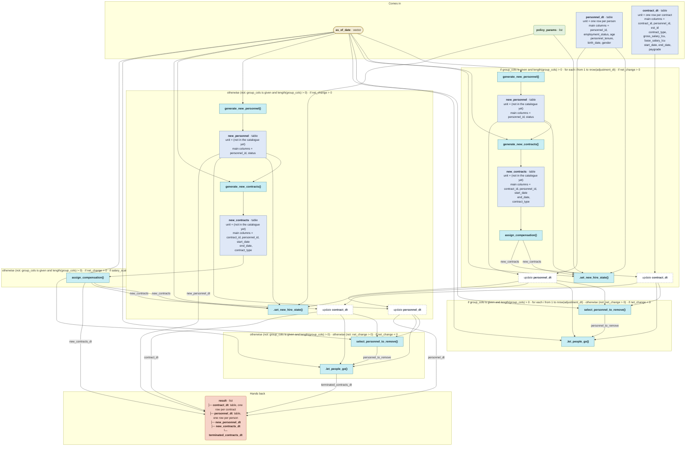

# `update_state_with_adjustment()`

Generated by `data-raw/schemas/build_code_map.R` from `R/hiring_update.R`. Do not edit by hand.

Steps with their own flow: 
- [`generate_new_personnel()`](generate_new_personnel.md)
- [`generate_new_contracts()`](generate_new_contracts.md)
- [`.set_new_hire_state()`](dot-set_new_hire_state.md)
- [`select_personnel_to_remove()`](select_personnel_to_remove.md)
